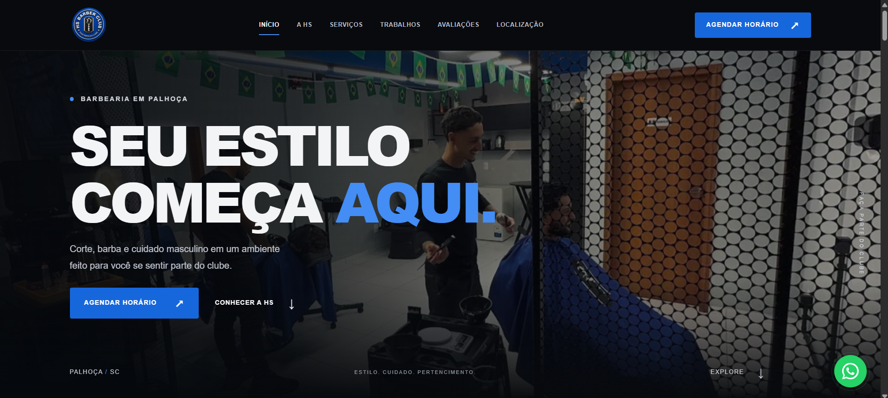

[](https://assisfilipee.github.io/hs-barber-club-barbearia/)

# HS Barber Club

Site institucional da HS Barber Club, barbearia em Palhoça, Santa Catarina. Uma apresentação digital com identidade visual marcante, serviços, galeria de trabalhos e acesso direto aos canais de agendamento.

**[Ver o projeto online ↗](https://assisfilipee.github.io/hs-barber-club-barbearia/)**

## Sobre o projeto

A página foi desenvolvida para apresentar a marca, valorizar o ambiente e os trabalhos da barbearia e facilitar o contato com novos clientes. O layout reúne fotografias do estabelecimento, tipografia de destaque e uma paleta escura com detalhes em azul.

A navegação em página única organiza as informações da experiência HS: apresentação da barbearia, serviços, galeria, clube de planos, avaliações, equipe e localização.

## Funcionalidades

- Layout responsivo para celulares, tablets e desktops.
- Menu mobile com controle de foco e fechamento pela tecla Escape.
- Galeria com ampliação das fotografias.
- Links para agendamento, WhatsApp, Instagram e rotas no Google Maps.
- Navegação por seções, indicação da seção ativa e botão de retorno ao topo.
- Animações de entrada e efeitos de rolagem com suporte à preferência por movimento reduzido.
- Metadados sociais e dados estruturados do tipo `HairSalon` para descrever o negócio.

## Tecnologias

| Tecnologia | Aplicação |
| --- | --- |
| HTML5 | Estrutura semântica e conteúdo |
| CSS3 | Identidade visual, responsividade e animações |
| JavaScript | Menu, galeria e interações |
| GitHub Pages | Hospedagem da versão de demonstração |

O projeto utiliza HTML, CSS e JavaScript puro, sem frameworks ou dependências de produção. Não é necessário instalar pacotes ou executar uma etapa de build.

## Estrutura

```text
hs-barber-club-barbearia/
├── assets/
│   ├── css/
│   │   └── style.css
│   ├── img/
│   │   └── Fotografias, logotipo e preview
│   └── js/
│       └── main.js
├── .gitignore
├── index.html
└── README.md
```

## Executar localmente

1. Clone o repositório:

   ```bash
   git clone https://github.com/assisfilipee/hs-barber-club-barbearia.git
   ```

2. Acesse a pasta:

   ```bash
   cd hs-barber-club-barbearia
   ```

3. Abra `index.html` no navegador ou sirva a pasta com um servidor estático de sua preferência.

## Personalização e publicação definitiva

As principais configurações de comportamento ficam em `SITE_CONFIG`, no arquivo `assets/js/main.js`. Os textos e links estão em `index.html`, e os estilos em `assets/css/style.css`.

Para a entrega definitiva, completar os dados ainda pendentes:

- **Domínio:** definir `canonicalUrl`, adicionar os metadados estáticos `canonical` e `og:url` e usar URLs absolutas nas imagens de compartilhamento. Criar `robots.txt` e `sitemap.xml` conforme o endereço definitivo.
- **Avaliações:** informar o link exato do Perfil da Empresa no Google em `googleReviewsUrl`. O botão correspondente permanece desativado até essa configuração. Os espaços de depoimentos estão ocultos e devem receber apenas textos e autores confirmados.
- **Equipe e planos:** complementar nomes, perfis profissionais, valores e condições quando fornecidos. Os botões de planos já direcionam para a página da barbearia na Beacons.

## Validação

Conforme o registro da primeira versão, os testes locais no Chrome em 3 de outubro de 2026 cobriram larguras de 320 a 1920 px, navegação por âncoras, menu mobile, galeria, carregamento de imagens e comportamento sem JavaScript. Também foram conferidos a sintaxe do JavaScript, os destinos internos e o JSON-LD.

A validação em Safari/iOS, em aparelhos físicos e a medição de Core Web Vitals em produção permanecem pendentes.

## Desenvolvimento

Desenvolvido por **[Filipe Assis](https://github.com/assisfilipee)**.
